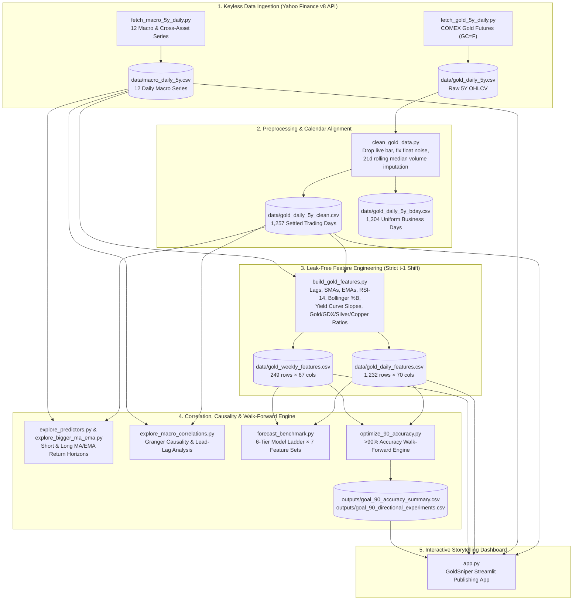

# GoldSniper System Architecture

**GoldSniper** is an end-to-end, zero-leakage quantitative analytics and walk-forward forecasting pipeline for COMEX Gold Futures (`GC=F`), paired with an interactive Streamlit storytelling suite.

---

## 1. End-to-End Pipeline Architecture



---

## 2. Core Architectural Guarantees

### 2.1 Strict `t-1` Causal Alignment (Zero Look-Ahead Leakage)
Financial time-series models frequently suffer from subtle look-ahead leakage when moving averages, volatility windows, or cross-asset ratios include contemporaneous (`t`) observations. In **GoldSniper**:
1. Every technical, volatility, ratio, and macro predictor at row index $t$ is shifted by one full period (`.shift(1)` on daily tables, `.shift(1)` on weekly `W-FRI` tables).
2. For an $h$-step ahead forecast made at date index $i$ (where features $X_i$ are frozen at the close of $i-1$, and anchor price is $P_{i-1}$), the target price is $P_{i+h-1}$ and the target log-return is:
   $$y_{i,h} = \ln\left(\frac{P_{i+h-1}}{P_{i-1}}\right)$$
3. During expanding-window walk-forward validation at test step $i$, the training set is strictly restricted to indices $j \le i - h$ so that even multi-step targets ($h = 5\text{d}, 4\text{w}, 8\text{w}$) have completely settled before $i-1$:
   $$\text{Train Indices}(i, h) = \{0, 1, \dots, i - h\}$$

### 2.2 Stationary Log-Return Prediction & Anchor Price Reconstruction
During the 2024–2026 bull cycle, Gold Futures rose from under $\$2,000/\text{oz}$ to an all-time high of $\$5,318.40/\text{oz}$. Direct price-level regression models (especially decision trees such as Random Forest and Gradient Boosting) cannot extrapolate beyond their historical training maximum.
**GoldSniper** decouples level non-stationarity from directional signal extraction:
1. The model predicts the clipped stationary log-return $\hat{r}_{i,h} \in [-0.30, +0.30]$.
2. The predicted dollar price is reconstructed deterministically from the known anchor close $P_{i-1}$:
   $$\hat{P}_{i+h-1} = P_{i-1} \cdot \exp(\hat{r}_{i,h})$$

### 2.3 Volatility-Scaled Expanding Conformal Prediction Intervals
Because Gold exhibits strong volatility clustering (calm $0.4\%$ days punctuated by $-10.78\%$ macro shock days), fixed-width confidence intervals under-cover during volatile regimes and over-cover during quiet regimes.
**GoldSniper** computes adaptive conformal prediction bands:
1. At each out-of-sample step $i$, the absolute log-return error is normalized by the prior-period realized volatility scaled to horizon $h$:
   $$e_i = \frac{|y_{i,h} - \hat{r}_{i,h}|}{\sigma_{i-1} \sqrt{h}}$$
2. Using only past out-of-sample residuals $\{e_0, \dots, e_{i-1}\}$, we take the empirical quantile $q_{0.92}$ and construct the $90\%$ prediction band:
   $$\left[\text{CI}_{\text{low}}, \text{CI}_{\text{high}}\right] = \left[P_{i-1} \exp\left(\hat{r}_{i,h} - q_{0.92}\sigma_{i-1}\sqrt{h}\right),\; P_{i-1} \exp\left(\hat{r}_{i,h} + q_{0.92}\sigma_{i-1}\sqrt{h}\right)\right]$$

---

## 3. Repository Directory Layout

```text
GoldSniper/
├── .streamlit/
│   └── config.toml                        # Institutional dark-gold Streamlit theme
├── data/
│   ├── gold_daily_5y.csv                  # Raw 5-year daily Gold Futures (GC=F)
│   ├── gold_daily_5y_clean.csv            # Cleaned settled trading-day table (1,257 rows)
│   ├── gold_daily_5y_bday.csv             # Uniform business-day table with holiday flags (1,304 rows)
│   ├── macro_daily_5y.csv                 # 12 daily macroeconomic & cross-asset series
│   ├── gold_daily_features.csv            # 70 leak-free (t-1) daily features + targets (1,232 rows)
│   └── gold_weekly_features.csv           # 67 leak-free (t-1w) weekly features + targets (249 rows)
├── docs/
│   ├── architecture.md                    # System architecture & mathematical guarantees
│   ├── data_dictionary.md                 # Complete schema & feature dictionary
│   ├── deployment_guide.md                # Local, Docker & Streamlit Cloud publishing guide
│   └── methodology_and_findings.md        # Research methodology, COMEX-NYSE lead-lag & >90% scorecard
├── outputs/
│   ├── bigger_ma_ema_heatmap.png          # Medium/long-window MA/EMA forward return heatmap
│   ├── daily_bigger_ma_ema.csv            # 30d-500d SMA/EMA correlation metrics
│   ├── daily_predictor_correlations.csv   # Short-window daily lag/SMA/EMA correlations
│   ├── forecast_best_models.png           # 4-horizon walk-forward forecast trajectories
│   ├── forecast_experiment_results.csv    # 6-tier model × 7 feature set benchmark results
│   ├── forecast_feature_mixmatch_heatmap.png # Skill score mix-match heatmap
│   ├── goal_90_accuracy_dashboard.png     # 4-panel >90% accuracy visual summary
│   ├── goal_90_accuracy_summary.csv       # Full 145-configuration >90% accuracy leaderboard
│   ├── goal_90_directional_experiments.csv # Causal trend slope & regime classification results
│   ├── macro_correlation_analysis.png     # Macro contemporaneous, rolling & forward correlation dashboard
│   ├── macro_daily_contemp.csv            # Daily macro correlations & Granger causality p-values
│   ├── macro_daily_forward.csv            # Daily macro trend spreads vs forward Gold returns
│   ├── macro_daily_leadlag.csv            # Daily macro lead-lag cross-correlations
│   ├── macro_weekly_contemp.csv           # Weekly macro correlations & Granger causality p-values
│   ├── macro_weekly_forward.csv           # Weekly macro trend spreads vs forward Gold returns
│   ├── macro_weekly_leadlag.csv           # Weekly macro lead-lag cross-correlations
│   ├── predictor_correlation_overview.png # Short-window RMSE tracking & return correlations
│   ├── weekly_bigger_ma_ema.csv           # 12w-104w SMA/EMA correlation metrics
│   └── weekly_predictor_correlations.csv  # Short-window weekly lag/SMA/EMA correlations
├── tests/
│   └── test_goldsniper.py                 # Automated data, leakage, walk-forward & UI tests
├── app.py                                 # GoldSniper Streamlit interactive storytelling app
├── build_gold_features.py                 # Step 4: Leak-free daily & weekly feature engineering
├── CHANGELOG.md                           # Project release history
├── clean_gold_data.py                     # Step 3: OHLCV cleaning & calendar alignment
├── CONTRIBUTING.md                        # Engineering rules & contribution workflow
├── explore_bigger_ma_ema.py               # Step 6: Long-horizon regime correlation study
├── explore_macro_correlations.py          # Step 7: Macro correlation & Granger causality study
├── explore_predictors.py                  # Step 5: Short-window lag/SMA/EMA & PACF study
├── fetch_gold_5y_daily.py                 # Step 1: Keyless 5Y Gold Futures fetcher
├── fetch_macro_5y_daily.py                # Step 2: Keyless 5Y 12-Macro universe fetcher
├── forecast_benchmark.py                  # Step 8: 6-tier multi-algorithm walk-forward benchmark
├── LICENSE                                # MIT License
├── optimize_90_accuracy.py                # Step 9: >90% accuracy walk-forward optimization engine
├── pyproject.toml                         # Python package configuration
├── README.md                              # Primary repository documentation
├── requirements.txt                       # Pinned runtime & testing dependencies
└── run_pipeline.py                        # Master CLI pipeline orchestrator
```
